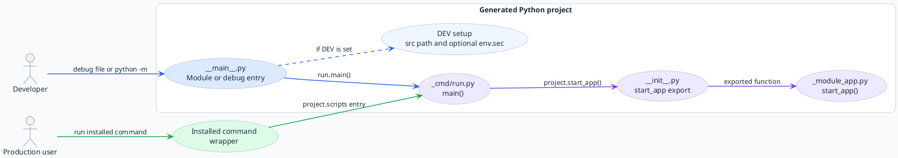

# oil-price-v2-xethhung12

Version 2 of [oil-price-hk](https://github.com/xh-dev/oil-price-hk). It collects Hong Kong fuel
discount information from the Consumer Council
([oil-price.consumer.org.hk](https://oil-price.consumer.org.hk/en)), decodes it down to
**station, weekday and benefit level** (money discount, points, voucher, upgrade), and publishes it
as JSON and a static HTML page.

Run the commands below from the project root, where `pyproject.toml` is located.

## Specification

### Background

v1 had two problems:

1. The server blocks requests coming from GitHub Actions runners.
2. The hand-written regular expressions no longer match the wording and markup of the site.

v2 keeps the v1 data granularity (see `json-data/*.json` and `price-info.json` in v1) but
reads the free text of the offers with an LLM (via LangChain), so a change of wording no longer
needs a code change. A rule based reader (no AI) is kept as an alternative.

### Sources

| Page | Used for |
|---|---|
| `/{lang}/weekly-discount` | All discounts of the next 7 days (a table: product x category x day). |
| `/{lang}/today-discount` | Pump (list) price of each product. |

`{lang}` is `tc` (Traditional Chinese) or `en`; by default both are fetched and decoded. The table is read by code (`weekly_page.py`); only the
**text of each cell** is interpreted by the LLM or the rules.

### Command line

Install from PyPI with `pip install oil-price-v2-xethhung12`. The import package is `oil_price_v2_xethhung12`;
the installed command is still `oil-price-v2`.

Entry point: `oil-price-v2 <command> [options]` (or `python -m oil_price_v2_xethhung12 <command>`).

| Command | Description | Reads | Writes |
|---|---|---|---|
| `refresh` | `fetch` + `decode` + `gen-html`. Stops at the first failure. | website | all of the below |
| `fetch` | Downloads the today and weekly pages of each language. | website | `<work-dir>/today.<lang>.html`, `<work-dir>/weekly.<lang>.html` |
| `decode` | Decodes the HTML into structured JSON, one file per language. | the HTML files | `<decoded-dir>/prices.<lang>.json` |
| `gen-html` | Renders the JSON files into one static HTML page that can switch language. | `<decoded-dir>/prices.<lang>.json` | `<out-dir>/index.html` |
| `gen-dockerfile` | Writes a `Dockerfile` (and `.dockerignore`) to build a deployable image. | - | `./Dockerfile` |

| Option | Default | Applies to | Description |
|---|---|---|---|
| `--work-dir` | `data` | all | Directory of intermediate files. |
| `--site` | `https://oil-price.consumer.org.hk` | `refresh`, `fetch`, `decode` | Website address. |
| `--lang` | `all` | `refresh`, `fetch`, `decode` | `all`, `tc` or `en`. |
| `--decoder` | `llm` | `refresh`, `decode` | `llm` or `rules`. |
| `--provider`, `--model`, `--base-url` | see below | `refresh`, `decode` | LLM selection. |
| `--prompt-file` | built-in | `refresh`, `decode` | Replace the LLM prompt text. |
| `--no-verify` | off | `refresh`, `decode` | Skip the language comparison after decoding. |
| `--fix-rounds` | `3` | `refresh`, `decode` | Maximum rounds of re-decoding mismatched products. |
| `--strict` | off | `refresh`, `decode` | Fail without writing decoded files if language differences remain. |
| `--output` | per command | `decode` (single `--lang` only), `gen-html` | Output file. |
| `--input` | every `<decoded-dir>/prices.<lang>.json` | `gen-html` | JSON file(s) to render, one per language. |
| `--out-dir` | `site` | `refresh`, `gen-html` | Directory of the generated site. |
| `-v` | off | all | Debug logging. |

Exit codes: `0` success, `1` runtime failure (network, LLM, validation), `2` usage error.

By default, if the language comparison still finds differences after the fix rounds, `decode`
writes both reports with the mismatches and `refresh` continues to generate HTML showing the differences
in a table, including offers found only in Chinese or English. Use `--strict` to stop instead. Language
comparison is skipped for a single language or the rules decoder.

### LLM configuration

| Option | Environment variable | Example |
|---|---|---|
| `--provider` | `OIL_PRICE_LLM_PROVIDER` | `ollama`, `openai` |
| `--model` | `OIL_PRICE_LLM_MODEL` | `qwen3.6:35b-mlx-cust` |
| `--base-url` | `OIL_PRICE_LLM_BASE_URL` | `http://192.168.1.10:11434` (remote Ollama) |
| | `OIL_PRICE_LLM_NUM_CTX` | Ollama context window, default `16384` |
| | provider key, e.g. `OPENAI_API_KEY` | |

The command line overrides the environment. Secrets are never committed; locally they can be
loaded from `env.sec` (see [Environment secrets](#environment-secrets)).

### Data model (`prices.<lang>.json`)

Same idea as v1 `price-info.json`: one entry per product, one record per day and benefit.

```json
{
  "source_url": "https://oil-price.consumer.org.hk/en/weekly-discount",
  "fetched_at": "2026-11-26T00:13:54+08:00",
  "decoder": "llm",
  "products": [
    {
      "name": "Sinopec - SINO Power (Standard Petrol)",
      "company": "Sinopec",
      "product": "SINO Power",
      "fuel_type": "Standard Petrol",
      "pump_price": 34.72,
      "discounts": [
        {
          "date": "2026-11-28",
          "day_of_week": "Sat",
          "category": "Member Special Promotion",
          "model": "points",
          "points": 70.0,
          "criteria": {
            "min_purchase_hkd": 100.0,
            "membership_card": "X Card",
            "locations_excluded": ["Chai Wan", "MacDonnell Road", "Kennedy Road", "Peak Road"]
          },
          "weekdays": ["Sat", "Sun"],
          "description": "X card members can earn 35 points ... (2X points from Saturday to Sunday) ..."
        }
      ]
    }
  ]
}
```

A record has:

| Field | Meaning |
|---|---|
| `date`, `day_of_week`, `category` | The day and the table row (Walk-in Discount, Designated Station Discount, ...). |
| `model` | `discount` (money off per litre), `points`, `voucher`, `upgrade`, or `other` (text kept, not understood). |
| `discount_per_litre` | HKD off per litre (`model=discount`). |
| `voucher_value_hkd` | HKD value (`model=voucher`). |
| `points`, `points_per_hkd`, `points_per_litre` | Points earned, and per how much (`model=points`). `points` already includes weekday bonuses such as 2X. |
| `upgrade_from`, `upgrade_to` | Free grade upgrade (`model=upgrade`). |
| `criteria` | `min_purchase_hkd`, `locations` (only at), `locations_excluded` (not at), `membership_card`, `credit_card`, `time_from`, `time_to`. |
| `weekdays` | Weekdays the benefit applies to (empty = every day). |
| `description` | Original cell text, for traceability. |

Unknown values are `null` / empty, never guessed. `source_url`, `fetched_at`, dates, pump prices and
`description` are set by code, not by the LLM.

### Validation rules

- `decode` fails (and keeps the previous `prices.json`) if the table or dates cannot be read, no
  product is found, a pump price is outside 0-200 or a discount outside 0-100.
- A cell the decoder cannot understand becomes `model: "other"` instead of being dropped.

### Non-functional requirements

- `fetch`: browser-like headers, timeout, limited retries with backoff; a clear message on 403/429.
- GitHub-hosted runners are blocked, so run `refresh` from a self-hosted runner or a local
  machine/cron. The commands are separate so only `fetch` has to run where the site is reachable.
- Output files are written atomically.
- LLM temperature is 0; output length is capped (a looping model fails fast and is retried once).

## Design

### Pipeline

```text
 fetch                          decode                                            gen-html
 site -> today.html     weekly_page.py      interpreter (llm | rules)    expand
      -> weekly.html -> cells with the  -> benefits of each cell   ->  one record per   -> prices.json -> index.html
                        days they cover     (no dates)                  date x benefit      (pydantic)     (Jinja2)
```

Stages only communicate through files, so each can be run and tested alone.
**Dates are never the LLM's job**: code reads the table, knows which days each cell covers
(`colspan`) and expands the decoded benefits over those days. The LLM only reads one short text at a
time and fills a small schema. One LLM call per product (about 5-9 cells).

### Layout

```text
src/oil_price_v2_xethhung12/
├── __main__.py            # dev entry (DEV handling)
├── _cmd/run.py            # argparse parser; calls the functions below
├── _module_app.py         # fetch / decode / gen_html / refresh (one function per command)
├── config.py              # defaults, file names, environment variable names
├── errors.py              # OilPriceError (expected failures)
├── files.py               # read text, atomic write
├── fetcher.py             # HTTP download
├── weekly_page.py         # weekly table -> cells (selectors at the top of the file)
├── today_page.py          # pump prices (selectors at the top of the file)
├── decoder.py             # build_report(): tables + interpreter + expand -> PriceReport
├── interpreters.py        # registry: "llm", "rules"  (add new interpreters here)
├── interpreter_llm.py     # LangChain structured output
├── interpreter_rules.py   # regular expressions, no AI (English and Traditional Chinese wording)
├── models.py              # pydantic models: the prices.json contract
├── renderer.py            # JSON -> HTML (plain-words description of each record)
├── prompts/decode_cells.md       # the LLM prompt: a plain text file
└── templates/index.html.j2       # the page template: plain HTML
```

### Generated page (`gen-html`)

- **Price ranking** at the top: products sorted by price, lowest first, one column per day
  (click a day to sort by it). Price = pump price minus the biggest plain per-litre discount of
  that day, i.e. a `discount` record with no station restriction, no minimum spend and no credit
  card (a membership card may be needed and is shown). Station-specific offers, vouchers and
  points are not part of this price. The pump price is today's, assumed unchanged for the week.
  Days with no discount in the table show the pump price.
- **One detail table per product** (same order): a "Best price" row, then one row per category and
  one column per day, with a coloured tag per benefit type.
- **Language switch**: the page contains every language it was given (`tc` and `en`) and shows one
  at a time. Buttons at the top right switch between them, and the choice is remembered in the
  browser. It opens in Chinese (the first of `LANGS` in `config.py`); `index.html?lang=en` opens
  it in English. Each language block is rendered from its own `prices.<lang>.json` (`lang` field),
  with labels from `LABELS` in `renderer.py` (add a language there and in `config.LANGS`).
- Single self-contained file (CSS and a few lines of JavaScript), responsive, light and dark mode.
  The look is `templates/index.html.j2`; the price rule is `day_price()` in `renderer.py`.

### Docker (nginx)
The image is plain nginx (`nginx:alpine`) serving the generated page; no Python
at run time.
```shell
oil-price-v2 refresh                   # make site/ (anywhere the site and your LLM are reachable)
oil-price-v2 gen-dockerfile            # -> ./Dockerfile and ./.dockerignore (--force to replace, --output - for stdout)
docker build -t oil-price-v2 .         # from the project root: nginx + site/
docker run -d -p 8080:8080 oil-price-v2   # http://localhost:8080/
```
`gen-dockerfile --build-site` makes the image generate the page itself in a first (Python) build stage,
so only `docker build` is needed; the default decoder there is `rules`, an LLM can be given with
`--build-arg OIL_PRICE_DECODER=llm --build-arg OIL_PRICE_LLM_PROVIDER=... --build-arg OIL_PRICE_LLM_MODEL=...
--build-arg OIL_PRICE_LLM_BASE_URL=...` (the comments at the top of the generated file show an Ollama example).
Other options: `--port` (default 8080), `--python-version` (build stage). The page does not refresh by
itself: rebuild the image regularly (cron or CI) to publish new data. The build machine must reach the
Consumer Council site (it blocks some networks, e.g. GitHub-hosted runners).
### Keeping it modifiable (also without AI)

- `prices.json` is plain JSON with a documented schema. It can be edited by hand, or produced by
  any other tool, and `gen-html` will render it.
- Every stage is a small module. If the site layout changes, only the selectors at the top of
  `weekly_page.py` / `today_page.py` change.
- `--decoder rules` needs no AI. If the wording changes, add or fix a regular expression in
  `interpreter_rules.py`; text no rule understands is kept as `model: "other"`. Rules know the
  English and Traditional Chinese wording.
- The LLM prompt (`prompts/decode_cells.md`) and the page template are plain files.
  Use `--prompt-file` to try another prompt without touching the code.
- A new decoder is one function `(ProductTable) -> {cell_id: [Benefit]}` registered in
  `interpreters.py`.

### Dependencies (`requirements.txt`)

`langchain`, `langchain-ollama` (default provider here), `langchain-openai` (optional), `pydantic`,
`httpx`, `beautifulsoup4`, `jinja2`. `argparse` is in the standard library.

### Error handling

| Failure | Behaviour |
|---|---|
| Network error / 403 / 429 | `fetch` retries, then exits `1`; no file replaced. |
| LLM unreachable / invalid output | Retried once per product, then `decode` exits `1`; `prices.json` kept. |
| LLM skips a cell | Warning; the cell is kept as `model: "other"`. |
| Missing input file | Exit `1` naming the command that creates it. |

### Known limits

- The model decides the quality of details such as `locations` and `time_from`. On the sample week,
  `qwen3.6:35b-mlx-cust` matched `--decoder rules` on 165 of 187 records and read the station-specific
  Chai Wan point bonuses that rules cannot (but without the station and time window);
  `gemma4:latest` matched far fewer (105). Compare with `--decoder rules` when trying a model.
- A few deterministic fixes run on the LLM result (`normalise_benefit` in `interpreter_rules.py`):
  "full day" is not a time window, and exclusions / minimum spend are filled from the text when the
  model left them out. They only fill gaps.
- `rules` leaves station-specific point bonuses ("At Chai Wan station, 4X points ...") as `other`.
- LLM runs for the whole week take about 1-2 minutes locally (10 calls); thinking is switched off for Ollama.

### Try it step by step

```shell
./install-dependencies.sh
oil-price-v2 fetch                             # -> data/today.<lang>.html, data/weekly.<lang>.html
oil-price-v2 decode --decoder rules            # -> decoded/prices.<lang>.json (no AI)
export OIL_PRICE_LLM_PROVIDER=ollama OIL_PRICE_LLM_MODEL=qwen3.6:35b-mlx-cust
oil-price-v2 decode --lang tc --output decoded/llm.json   # same, using the LLM, one language
oil-price-v2 gen-html                          # -> site/index.html (Chinese by default, switchable to English)
oil-price-v2 refresh                           # all of the above
```

## Project skeleton notes

The remaining sections describe the generated project skeleton and its tooling.

## Project structure

```text
.
├── .gitignore
├── LICENSE
├── README.md
├── pyproject.toml
├── requirements.txt
├── dev-requirements.txt
├── install-dependencies.sh
├── build.sh
├── build-and-deploy.sh
├── scripts/
│   └── sync-requirements.py
└── src/
    └── oil_price_v2_xethhung12/
        ├── __init__.py
        ├── __main__.py
        ├── _module_app.py
        ├── _cmd/
        │   └── run.py
        └── ...            # application modules, prompts and templates: see "Layout" above
```

- `pyproject.toml` defines package metadata, runtime dependencies, and the
  `oil-price-v2` installed command. `requirements.txt` is the source
  of truth for runtime dependencies; `scripts/sync-requirements.py` copies them into
  `project.dependencies` before builds.
- `dev-requirements.txt` lists development tools. `install-dependencies.sh`
  installs both requirements files.
- `build.sh` builds distributions; `build-and-deploy.sh` builds and uploads
  them. `LICENSE`, `.gitignore`, and this `README.md` provide the initial
  license, ignore rules, and project documentation.
- `_module_app.py` contains the functions `fetch`, `decode`, `gen_html` and
  `refresh`, exported by `__init__.py`. `_cmd/run.py` parses the command line,
  calls them, and is the installed command's entry point.
- `__main__.py` supports `python -m oil_price_v2_xethhung12` and calls the same
  command entry point. Its optional development secrets loading is described
  below.

## Development and release call routes


<details>
<summary>PlantUML source</summary>



</details>

The SVG URL contains the compressed PlantUML source; regenerate the URL after
editing the diagram.

`__init__.py` exports `start_app` from `_module_app.py`; `_cmd/run.py` imports
the package and calls that export. Both routes run the same command and
application code. The module route also works after installation; it is not
restricted to development.

### Source development and debugging

Install the development tools and dependencies with
`./install-dependencies.sh`. In a debugger, run
`src/oil_price_v2_xethhung12/__main__.py` as a Python file, set the working
directory to the project root, and set `DEV=1` in the debug configuration.
The `DEV` block adds the `src` directory to `sys.path`, allowing imports from
the source tree, and loads `env.sec` if present (see below). `DEV` is enabled
whenever the variable is present, even if its value is empty; it is not a
Python debugger switch.

Alternatively, make the source package discoverable before starting Python:

```shell
DEV=1 PYTHONPATH=src python -m oil_price_v2_xethhung12
```

An editable installation (`python -m pip install -e .`) also makes the source
package discoverable for `python -m`. Python resolves the package and executes
its `__init__.py` before `__main__.py` when using `-m`. Consequently,
`__main__.py` cannot fix package discovery for that invocation, and its
secrets loading occurs after `__init__.py` and `_module_app.py` have been
imported. Avoid reading secrets at their import time; read them inside
`start_app()` or later instead.

### Build and release

`./build.sh` first runs `scripts/sync-requirements.py`, then clears `dist/` and builds
distributions, including a wheel. `./build-and-deploy.sh` calls `build.sh`,
so it uses the same sync step. A sync or build failure stops the scripts
before building or uploading, respectively.
Install the resulting wheel with `python -m pip install <wheel-file>`; the
installer creates `oil-price-v2` from this configuration:

```toml
[project.scripts]
oil-price-v2 = "oil_price_v2_xethhung12._cmd.run:main"
```

The wheel is an installation archive, not a command that runs by itself. The
installed command invokes `_cmd.run.main` directly and does not execute
`__main__.py`, so it neither changes `sys.path` nor loads `env.sec`, even if
`DEV` is set. Supply release configuration through the environment or your
own configuration mechanism. Running `python -m oil_price_v2_xethhung12` after
installation still uses `__main__.py` and its `DEV` behavior.

`./build-and-deploy.sh` builds and uploads the distributions with Twine.
Review the package metadata, version, license, dependencies, and publication
target before uploading.

### Runtime dependency synchronization

Edit `requirements.txt`, not `project.dependencies` in `pyproject.toml`.
Each build replaces that dependency array, preserving the remaining TOML
configuration and comments. An empty requirements file clears runtime
dependencies. Development dependencies are not copied into wheel metadata.
To sync without building, run `python scripts/sync-requirements.py`.

Use one PEP 508 requirement per line, for example:

```text
requests>=2.32
httpx[http2]>=0.28
importlib-metadata>=8; python_version < "3.12"
```

Blank lines, full-line comments, and inline comments separated by whitespace
are supported. Pip-specific options (`-r`, `-e`, index URLs, hashes), bare
paths, and line continuations are not supported; invalid entries stop the
sync without changing `pyproject.toml`. Install development dependencies
first: the sync script uses `packaging` for validation and `tomlkit` to
preserve TOML formatting.

### Customizing the starter

- Replace or extend `start_app()` in `_module_app.py` with application logic.
  Update its export in `__init__.py` and the call in `_cmd/run.py` if you
  change its name or signature.
- Put shared command-line parsing and startup logic in `_cmd/run.py` so both
  entry routes use it. If you change the installed entry point, update
  `[project.scripts]` in `pyproject.toml`.
- Keep development-only setup in `__main__.py`; move any setup required by
  both routes into shared code instead. Do not rely on `DEV` or `env.sec`
  for the installed command.
- Declare packages needed at runtime in `requirements.txt`; the build sync
  updates `pyproject.toml` so wheel installation installs them.
  Put development-only tools in `dev-requirements.txt`.

## Execution
Run through python interpreter:
```shell
python -m oil_price_v2_xethhung12
```

Run through python project script
```shell
oil-price-v2
```

### Environment secrets
When running `python -m oil_price_v2_xethhung12` with `DEV` set, the application
loads key-value pairs from `env.sec` in the current working directory into
the process environment if the file exists, replacing existing values with
the same names. The file must be encrypted using
[py-secrets-xethhung12](https://github.com/xh-dev/py-secrets-xethhung12).
The encryption key is resolved through the default OS keyring, or the
`SECRETS_KEY` environment variable if no keyring key is available. For example:

```shell
py-secrets-xethhung12 -f env.sec set MY_SETTING my-value
DEV=1 python -m oil_price_v2_xethhung12
```

Without `DEV`, or when `env.sec` is absent, no secrets are loaded. The
installed project script does not use this module entry point and does not
load `env.sec`. The secrets package is a development dependency, not a
runtime dependency.

## Development
The project requires `python` (3+ version) installed and `pip` ready for use on adding manage dependencies

#### Tools
|Name|Platform|Type|Description|
|---|---|---|---|
|install-dependencies.sh|shell|script| The scripts for installing depencies required|
|build.sh|shell|script| The scripts for build the package|
|scripts/sync-requirements.py|Python|script| Sync runtime dependencies into pyproject.toml before builds|
|build-and-deploy.sh|shell|script| The scripts for build and deploy the package|

* install-dependencies.sh
The script will install dependencies listed in `dev-requirements.txt` and `requirements.txt`. The first requirement file contains the dependencies for development like build and deploy tools. The second requirement file defined all required dependencies for the making the package works (**actual dependencies**).

## Useful Scripts
### Project Versioning
For version update in `pyproject.toml`.
This project use package [`xh-py-project-versioning`](https://github.com/xh-dev/xh-py-project-versioning) to manipulate the project version.

Simple usage includes:\
Base on current version, update the patch number with dev id
`python -m xh_py_project_versioning --patch` \
In case current version is `0.0.1`, the updated version will be `0.0.2-dev+000` 

To prompt the dev version to official version use command.
`python -m xh_py_project_versioning -r`.
Through the command, version `0.0.2-dev+000` will be prompt to `0.0.2` official versioning.

Base on current version, update the patch number directly
`python -m xh_py_project_versioning --patch -d` \
In case current version is `0.0.1`, the updated version will be `0.0.2` 

Base on current version, update the minor number directly
`python -m xh_py_project_versioning --minor -d` \
In case current version is `0.0.1`, the updated version will be `0.1.0` 

Base on current version, update the minor number directly
`python -m xh_py_project_versioning --minor -d` \
In case current version is `0.0.1`, the updated version will be `1.0.0` 